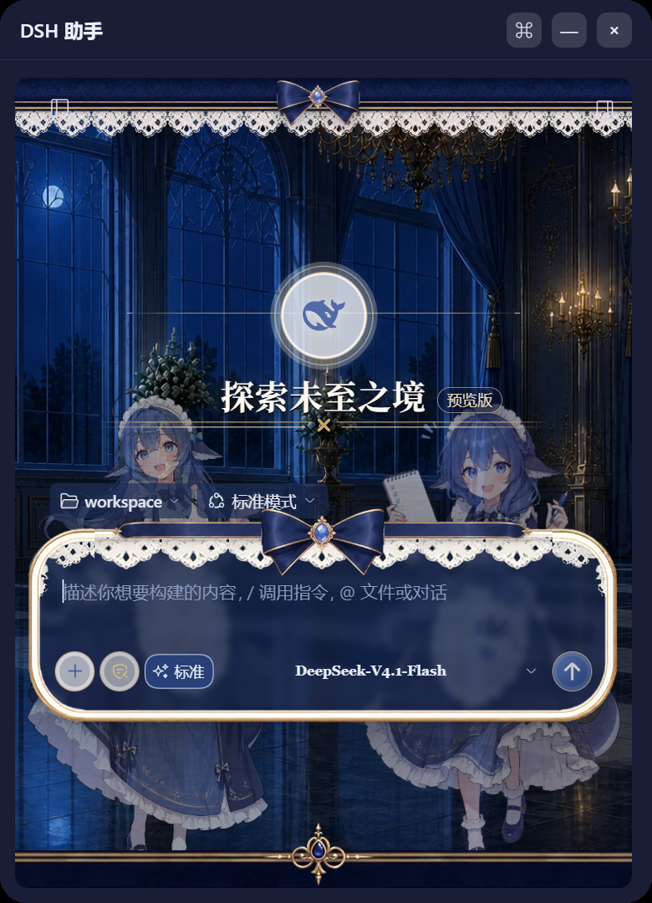
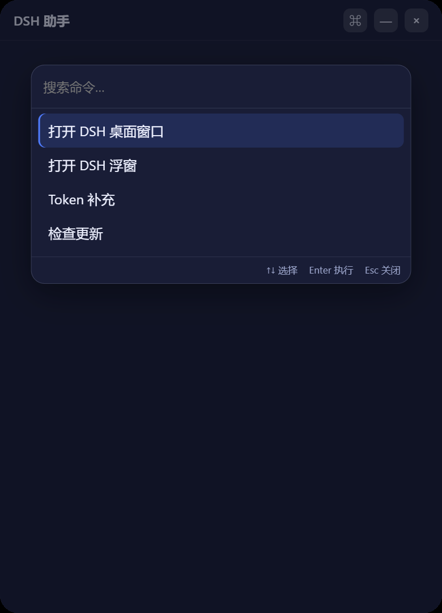

# DSH HUD

Windows 常驻悬浮胶囊 + 520×720 紧凑面板（豆包式）。点胶囊或按全局热键即可直接对话——面板内嵌整套 DSH Web UI，不用切回浏览器。

技术栈：Electron（44.7.0，随包分发）+ 一个很薄的 Cordis 插件（发现文件、计划任务拉起、登录自启、桌面/开始菜单快捷方式、IPC 桥、应用内更新源）。

当前版本：**0.4.2**（[Release](https://github.com/suianest/dsh-hud/releases/latest)）

## 截图

| 面板（520×720） | 命令面板（⌘ / Ctrl+K） |
|---|---|
|  |  |

胶囊：悬停时鲸鱼轮廓会亮起一圈荧光描边。


> 截图里的深蓝／金边配色来自下面推荐的社区皮肤，**不是 HUD 自带**；不装皮肤时面板会跟随 DSH 默认的浅色／深色主题。

### 推荐搭配：深海女仆工坊（UI 皮肤）

| 项 | 值 |
|---|---|
| 包名 | `@smalltailqwq/dsh-client-ui-skin-maid-atelier` |
| 最新版本 | 0.1.10（2026-11-06） |
| 安装 | DSH 插件市场搜索「深海女仆工坊」安装，或 `plugin_manager install_bundle @smalltailqwq/dsh-client-ui-skin-maid-atelier` |

装好后桌面版与 HUD 面板会同时套用这套皮肤（两者连的是同一个 DSH Web 服务），面板里不必再单独配置。
皮肤由 DSH 插件市场单独更新；HUD 的「检查更新」只更新 HUD 本体。

---

## 两种形态

| | 形态 A · 便携版 | 形态 B · DSH 插件形态 |
|---|---|---|
| 用户看到什么 | 一个解压目录，双击 `DSH HUD.lnk` | DSH 里多一个插件；插件代建登录启动项 + 桌面/开始菜单快捷方式 |
| 需要准备 | 应用包（zip） | 只需在 DSH 里装插件（应用包首次自动下载） |
| 怎么起来 | 双击快捷方式 / 开机自启 | 随 DSH 启动（计划任务）/ 登录自启 / 双击快捷方式 / `/dsh-hud on` |
| 插件是否必需 | 是（否则面板连不上 DSH，显示错误页） | 是 |

> 说明：插件形态下，**应用包由插件首次运行时自动从 Release 下载**（约 151 MB，校验 SHA-256 后解压到 `%LOCALAPPDATA%\DSH HUD`；设 `DSH_HUD_NO_AUTO_INSTALL=1` 可关）。插件由 DSH 宿主进程加载，直接 `spawn` Electron 会被系统拒绝（`0x80000003`，Chromium 在 JS 之前就崩），所以启动走的是**计划任务** `dsh-hud-launch`：任务在独立进程树、普通令牌下运行，不需要人工确认。插件形态指的是**装完不用自己管启动**，不是「只有插件就能跑」。

---

## 三条安装路线（都保留，任选其一）

| 路线 | 适合谁 | 怎么做 | 应用包 |
|---|---|---|---|
| **A · 便携版** | 只要桌面胶囊，不想碰插件 | 下载 `安装 DSH HUD.cmd` 双击，或解压 zip 后双击 `DSH HUD.lnk` | 安装器自动下载 |
| **B · GitHub 仓库装插件** | 有 git、想用仓库版（推荐开发者） | DSH 添加插件填 `github:suianest/dsh-hud`（或本地目录 `D:\...\dsh-hud`） | 插件首次运行自动下载 |
| **C · npm 包名装插件** | 只想填一个名字（等发布） | 填 `dsh-hud-capsule` | 插件首次运行自动下载 |

- **A** 见下一节；**B/C** 见「形态 B」。
- B 需要本机有 `git`（仓库自带 `installer\...` 不含 git，需自行安装或使用本文档附带的 PortableGit 说明）；C 需要先把包装到 npm（当前未发布，见 `docs/install-via-npm.md`）。
- 三条路线可以混用：先装便携版再装插件，插件会直接识别已有安装；反过来也行。

## 形态 A · 便携版（最简单）

**一键安装（推荐）**

1. 下载安装器（几百字节，二选一）：
   - [最新 Release](https://github.com/suianest/dsh-hud/releases/latest) 的附件 `安装 DSH HUD.cmd`；
   - 或在仓库里打开 `installer/安装 DSH HUD.cmd` → 右上角 **Raw** / 下载按钮（Release 附件漏传时用这条）。
2. 双击它。脚本会自动建目录、下载约 151 MB 安装包、校验 SHA-256、解压到 `%LOCALAPPDATA%\DSH HUD`，最后告诉你装在哪并问要不要现在启动。
3. 想装到别的盘：`powershell -ExecutionPolicy Bypass -File install-dsh-hud.ps1 -InstallDir "D:\Apps\DSH HUD"`；离线时加 `-ZipPath "手动下载的zip"`。

**手动安装**

1. 获取 `DSH-HUD-<版本>-win-x64.zip`（[最新 Release](https://github.com/suianest/dsh-hud/releases/latest) 或本地 `make-portable` 产物），解压到任意目录。
2. **双击 `DSH HUD.lnk`** 或 `启动 DSH HUD.cmd`。
3. 屏幕边缘出现胶囊即成功；右键胶囊 → 勾选「开机自启」。

> ⚠️ **不要双击 `app\DSH HUD.exe`**。它必须带 `--no-sandbox --user-data-dir=…` 才能启动，零参数会在 Chromium 初始化阶段直接崩（`0x80000003`，连日志都来不及写）。快捷方式里已经写好参数。

---

## 形态 B · DSH 插件形态（装完即用）

1. 解压应用包到任意目录（例如 `%LOCALAPPDATA%\DSH HUD`）。**不需要自己建快捷方式**，插件会代建。
2. 在 DSH 里安装插件（插件管理界面填仓库地址，或命令行）：

   ```bash
   # ① GitHub 仓库（需要 git）
   plugin_manager install_bundle github:suianest/dsh-hud
   # ② 本地目录（填仓库或解压后的目录）
   plugin_manager install_bundle D:\path\to\dsh-hud
   # ③ npm 包名（等发布后）
   plugin_manager install_bundle dsh-hud-capsule
   ```

   > `suianest/dsh-hud` 这种写法**不被识别**：DSH 只接受绝对路径、`github:`/`git:` 这类 git 形式、或合法 npm 名（详见 `docs/install-via-npm.md`）。

3. 插件负责：写 `%LOCALAPPDATA%\dsh-hud\discovery.json`（每 15s 刷新）、注册计划任务 `dsh-hud-launch`、写登录启动项、代建桌面与开始菜单快捷方式、处理 `/dsh-hud` 命令与 IPC 桥。
   **首次定位到打包版 HUD 时，插件会自动写一次登录启动项**（`Startup\dsh-hud.cmd`），并在同目录记下 `autostart.json`（`by: plugin-first-run`）——之后在右键菜单里关掉「开机自启」就不会被重新装上。想跳过这次自动安装，启动 DSH 前设 `DSH_HUD_NO_AUTOSTART=1`。
4. 重新登录一次（或 `/dsh-hud on`），胶囊出现，之后不用碰快捷方式。

   插件命令：

   | 命令 | 作用 |
   |---|---|
   | `/dsh-hud on` | 启动胶囊（走计划任务，无需人工确认） |
   | `/dsh-hud off` | 退出胶囊进程 |
   | `/dsh-hud status` | 查看是否在运行、安装路径 |
   | `/dsh-hud toggle` / `show` / `hide` / `reload` | 开关 / 显示 / 隐藏 / 重载已运行的胶囊 |

   **跟随 DSH 启动**：插件在 DSH 启动时用同一个计划任务把胶囊拉起来（默认开启）。不想要就设 `DSH_HUD_AUTOSTART_WITH_DSH=0`，或在右键菜单里关掉「开机自启」（那样连登录自启也一起关）。

   插件定位应用包的顺序：`config.hudDir` / `config.exePath` → 环境变量 `DSH_HUD_DIR` / `DSH_HUD_EXE` → `config.local.json` → 常见安装目录（`%LOCALAPPDATA%\DSH HUD\…`、`%LOCALAPPDATA%\Programs\DSH HUD\…`）→ 仓库 `dist\win-unpacked\app\DSH HUD.exe`（新布局优先，回退旧平铺）。都找不到时在日志和 `/dsh-hud` 里给出可读提示，不会崩。

---

## 原理：发现文件

面板靠**发现文件**找到正在运行的 DSH 服务，由插件写入：

```json
// %LOCALAPPDATA%\dsh-hud\discovery.json
{
  "pid": 1234,
  "port": "50265",
  "url": "http://127.0.0.1:50265/?token=…",
  "updatedAt": "2026-11-15T08:00:00.000Z",
  "protocolVersion": 1
}
```

- `url` 带一次性 `?token=`，HUD 用它换鉴权 cookie，之后自动切回无 token 的干净地址。
- 插件每 15s 原子刷新；DSH 退出时删除。
- 两端各有一个 `protocolVersion`，不一致时只 warn 不阻塞（当前都是 1）。
- 插件没装 / DSH 没起时，面板显示自绘错误页，带「重试」「启动 DSH」两个按钮，并每 5s 自动重连一次（最多约 2 分钟）。

---

## 使用

| 操作 | 效果 |
| --- | --- |
| 点击胶囊 | 展开 520×720 面板 |
| `Ctrl+Alt+Space` | 全局热键，展开 / 收起 |
| `Ctrl+K` 或面板标题栏 ⌘ 按钮 | 命令面板（可搜索动作，含「检查更新」），再按一次收起 |
| 拖动胶囊 / 面板标题栏 | 移动窗口；胶囊松手后吸附屏幕边缘（≤24px 触发，留 8px 间隙） |
| 拖面板左 / 右 / 上 / 下边缘 | 按住拖动改宽高；不按不动，不会自己增长 |
| 面板「—」按钮 / `Esc` | 收起为胶囊 |
| 右键胶囊或面板任意位置 | 打开 DSH 桌面窗口 / 打开 DSH 浮窗 / Token 补充 / 检查更新 / 退出 DSH 浮窗 / 开机自启 |

- **面板失焦默认不收起**（想恢复旧行为：`DSH_HUD_BLUR_COLLAPSE=1`）。
- 位置（胶囊与面板各自）记在用户数据目录，下次启动沿用；多屏 / DPI 变化会重新钳位。
- 内嵌页有完整输入框，直接对话即可（流式）。

---

## 应用内更新

右键 →「检查更新」（或命令面板里的同名项）：

1. 拉 `manifest.json`（按顺序试 raw.githubusercontent → jsDelivr → Release 资产 → GitHub REST API，前一条失败自动换下一条）；
2. 有更新时只下载 `app.asar`（约 0.5 MB），校验 sha256；
3. 退出 HUD，由独立脚本 `updater.cjs` 等锁释放后替换（保留 `app.asar.bak` 可回滚）并重新拉起。

运行时不会替换 `DSH HUD.exe`——Windows 上做不到，Electron 大版本升级属于 Release 事件。想手动检查：`/dsh-hud` 日志里会记 `update: checking` / `up to date` / `update available`。

---

## 目录结构

```
dsh-hud/
├─ app/                     # Electron 应用本体
│  ├─ main.js               # 单实例锁 / userData / 启动探针 / 扩展加载 / 快捷方式
│  ├─ preload.js            # shell 的 contextBridge（拖拽/收起/命令面板/缩放）
│  ├─ updater.cjs           # 独立更新脚本（替换 asar 后重启）
│  ├─ src/
│  │  ├─ hud-window.js      # 单窗口双态状态机 + 菜单 + 缩放 + 主题 + 更新
│  │  ├─ web-embed.js       # WebContentsView 内嵌 DSH Web UI
│  │  ├─ discovery.js       # 读 discovery.json（含 protocolVersion）
│  │  ├─ compact-css.js     # 520 紧凑 CSS 注入
│  │  ├─ extensions.js      # 扩展点（菜单 / 控制动作 / CSS / 外部扩展目录）
│  │  ├─ hotkeys.js         # 全局热键
│  │  ├─ autostart.js       # 开机自启（写 Startup 脚本）
│  │  ├─ shortcut.js        # 开始菜单快捷方式（HUD 侧兜底）
│  │  ├─ updater.js         # 检查/下载/暂存更新
│  │  ├─ config.js          # 路径与环境探测
│  │  └─ constants.js       # 尺寸 / 阈值
│  ├─ renderer/             # shell 界面（胶囊 / 面板 / 命令面板）
│  └─ scripts/              # run / check / build / make-portable
├─ plugin/                  # Cordis 插件（discovery / 计划任务 / IPC / 自启 / 快捷方式 / 命令）
├─ scripts/                 # setup.mjs（一键环境）、run-hud-capture.cmd、probe-webui.mjs
├─ tests/e2e/               # 单元与集成测试
├─ screenshots/             # README 用截图
├─ docs/                    # 设计、发布、可移植性、扩展说明、Release Notes
├─ manifest.json            # 应用内更新清单（随 Release 一起发布）
├─ dist/                    # 打包产物（make-portable.js）
└─ 操作日志/                # 一次性取证与实验归档（不入库）
```

---

## 开发

```bash
node scripts/setup.mjs            # 检查 Node、下载 Electron 44.7.0、写 config.local.json
node --test --test-force-exit tests/e2e/unit/   # 单测（必须带 --test-force-exit）
node app/scripts/make-portable.js # 打包到 dist/win-unpacked + zip + 快捷方式 + manifest
```

打包后目录：根下只有 `DSH HUD.lnk`、`启动 DSH HUD.cmd`、`README.txt`、`app/`、`udd/`，Electron 运行时都在 `app/` 里。

---

## 已知限制

- 必须带 `--no-sandbox` 启动（快捷方式 / 启动脚本已内置；直接双击 exe 会崩）。这是当前机器环境的限制，不是设计选择。
- 双屏、跨 DPI（100% ↔ 150%）缩放尚未真机验证。
- 打包为纯 JS 兜底（沙箱里 electron-builder 的 spawn 会被拒），exe 未嵌图标 / 版本资源。
- 插件直接 `spawn` Electron 不可行；启动统一走计划任务（无需管理员、不弹 UAC）。`spawnApp` / `shellLaunch` 两条实验路径默认关闭，留作调试。
- `manifest.json` 在部分网络下 raw / jsDelivr 不可达，靠四源回退；如果你的网络全挂，可在 `config.local.json` 里用 `DSH_HUD_MANIFEST_URL` 指到自建镜像。

## 许可证

MIT，见 [LICENSE](LICENSE)。
